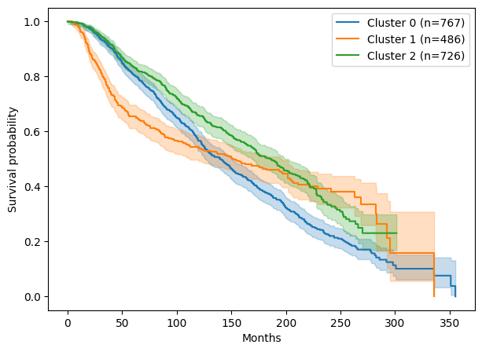

# Gene Expression Clusters and Survival in Breast Cancer (METABRIC)

A small, reproducible pipeline that groups breast cancer patients by gene expression and tests whether the groups differ in survival, then checks how much gene expression adds to survival prediction beyond clinical variables.


## Summary

- Gene-expression clusters, found without using any subtype labels, closely match known breast cancer subtypes and separate overall survival (log-rank p = 3.2e-5).
- For prediction, ten gene-expression components added a **modest and uncertain** improvement over clinical variables alone (concordance index 0.650 to 0.667).
- This is an exploratory analysis on a single cohort, not a clinical tool. See [Limitations](#limitations).

## Data

- **Cohort:** METABRIC breast cancer study (Curtis et al., *Nature*, 2012), downloaded from [cBioPortal](https://www.cbioportal.org/) as `brca_metabric.tar.gz`.
- **Files used:**
  - `data_clinical_patient.txt`: clinical variables and survival (`OS_MONTHS`, `OS_STATUS`).
  - `data_mrna_illumina_microarray.txt`: gene expression (microarray).
- **Size after matching:** 1,979 patients with expression and valid survival data, 20,374 genes. About 57.8% of these patients died during follow-up.
- The data is not included in this repository. Download it from cBioPortal and follow the instructions below.

## Method

1. **Load and match.** Read the clinical and expression files, merge duplicate gene names by averaging, and keep patients present in both files. Remove patients with missing or zero survival time.
2. **Survival variables.** Time is `OS_MONTHS`. The event is 1 if `OS_STATUS` starts with `1` (deceased) and 0 otherwise. Overall survival counts deaths from any cause.
3. **Feature selection.** Keep the 500 genes with the highest variance across patients, then standardize them.
4. **Dimension reduction.** PCA to 10 components, which keep about 46.9% of the variance in the 500 genes.
5. **Clustering.** KMeans with 3 clusters on the 10 components (fixed in advance, not tuned).
6. **Survival comparison.** Kaplan-Meier curves per cluster and a multivariate log-rank test.
7. **Cluster interpretation.** Cross-tabulate clusters against the `CLAUDIN_SUBTYPE` labels and compare mean age at diagnosis. These labels were not used to form the clusters.
8. **Prediction.** Cox proportional hazards models (penalizer 0.1) evaluated with 5-fold cross-validation repeated 3 times, reporting the concordance index (c-index).

## Results

### Clusters and survival

| Cluster | Patients | Mean age at diagnosis | Dominant subtypes |
|---|---|---|---|
| 0 | 767 | 65.7 | Luminal B (362), Luminal A (317) |
| 1 | 486 | 55.2 | Basal (196), claudin-low (145), Her2 (114) |
| 2 | 726 | 60.1 | Luminal A (382), Normal-like (122), Luminal B (97) |

- Cluster 1, made up mostly of Basal, claudin-low, and Her2 tumors, has the lowest survival early in follow-up.
- Cluster 2 has the best survival for most of the follow-up period.
- The survival curves cross after roughly 150 months, so the log-rank test (p = 3.2e-5) should be read as supportive evidence, not as a full description of the differences. Cluster 0 contains the oldest patients, and part of its late decline may reflect deaths from unrelated causes.
- Confidence bands become very wide after about 250 months because few patients remain.



### Prediction

Concordance index, mean ± standard deviation over cross-validation folds (0.5 is no better than chance):

| Model | Patients | c-index |
|---|---|---|
| Age at diagnosis only | 1,979 | 0.588 ± 0.022 |
| 10 gene components only | 1,979 | 0.598 ± 0.020 |
| Age + 10 gene components | 1,979 | 0.627 ± 0.020 |
| Clinical only (age, NPI, positive lymph nodes) | 1,903 | 0.650 ± 0.030 |
| Clinical + 10 gene components | 1,903 | 0.667 ± 0.027 |

Rows with missing clinical values were dropped for the last two models, so they should be compared with each other, not with the first three.

**Interpretation:** the gene components add a small gain over clinical variables (about 0.017 in c-index). Because the cross-validation folds are not independent, the true uncertainty is larger than the standard deviations shown, so this gain should be treated as suggestive, not established.

## Cluster stability

Stability was measured with 30 bootstrap resamples using the adjusted Rand index (1 = identical clusters). Clusters were fit on each resample and compared with the original clusters on all patients. The number of genes and components was held fixed.

| k | Stability (mean ± SD) |
|---|---|
| 2 | 0.97 ± 0.02 |
| 3 | 0.85 ± 0.14 |
| 4 | 0.91 ± 0.04 |
| 5 | 0.78 ± 0.19 |

k=3 was chosen in advance and is moderately stable but varies across resamples. Stability tends to favor small k and does not show that a clustering is biologically meaningful, so it was used as a check, not to choose k.

## Limitations

- **Preprocessing leakage.** Gene selection, scaling, PCA, and clustering used all patients before cross-validation. These steps do not use survival, so the effect is likely small, but a stricter design would run them inside each fold.
- **Fixed choices.** The number of genes (500) and components (10) were fixed, not tuned. The number of clusters (3) was chosen in advance, and stability was checked for k = 2 to 5.
- **Overall survival.** Deaths from any cause are counted, which is especially relevant for older patients.
- **Single cohort.** There is no external validation on an independent dataset.
- **Interpretation of clusters.** The cluster-to-subtype match confirms known biology. It is not a new discovery.
- **Cross-validation uncertainty.** Repeated cross-validation scores are correlated, so the reported standard deviations understate uncertainty.
- **Not for clinical use.**

## How to run

The analysis was run in Google Colab with Python 3.

1. Download `brca_metabric.tar.gz` from cBioPortal and place it where your notebook can read it (for example, mounted Google Drive).
2. Install the dependencies:
   ```
   pip install pandas numpy scikit-learn lifelines matplotlib
   ```
3. Open `analysis.ipynb`, update the file path in the first cells, and run all cells in order.

## Repository contents

- `analysis.ipynb`: the full analysis notebook.
- `km_curves.png`: Kaplan-Meier plot by cluster.
- `README.md`: this file.

## Possible next steps

- Run feature selection and dimension reduction inside each cross-validation fold.
- Compare PCA with supervised dimension-reduction methods.
- Tune the number of components and clusters with proper nested validation.
- Evaluate on an independent breast cancer cohort.
- Combine expression with other data types (for example, imaging).

## Acknowledgments

Data from the METABRIC cohort via cBioPortal. Built with pandas, scikit-learn, and lifelines.
